# Jonas Review：M 类装配体逐标签复核记录（德文原文与中文翻译）

- 来源：`Review_M_Regime_Template_Duanni.xlsx`，工作表 `BG-Label Template`，Excel 第 6–97 行。
- 范围：35 个装配体、92 行独立 Label；Review 中 58 行为 `passed`、34 行为 `failed`；24 行有非空 Anmerkung。
- 顺序：与原 Excel 完全一致，每一行对应一个装配体的一个独立候选 Label。
- 图片：按 SAP 编码匹配工作表 `Mehrdeutige BG (R2)` 的 F 列嵌入原图，并核对其与 `BG-Label Template` 的 D 列缩略图对应；每个 Label 行均显示对应装配体图片，同一 BG 复用同一张原图，点击图片可查看完整原图。
- 原文来源：SAP 编码取自 C 列，Label 取自 E 列，Begründung 取自 F 列；Jonas 的 Review 和 Anmerkung 分别取自隐藏的 Y 列和 Z 列。
- Begründung 是原表中针对候选分类的理由，不等同于 Jonas 对 Review 的解释；Jonas 的补充说明保留在 Anmerkung 列。中文翻译不补写留空理由，也不依据 Review 改写原文。
- `—` 表示原单元格为空。德文原文按原表保留，包括原有拼写和分类表述；单元格内换行以 ` ` 显示。
- 原表对应关系提示：0804LB1151 的 Excel 第 27 行 Label 为 `Multi-Achs-System (Gantry)`，但理由末尾写的是 `Kombinierte Einheit`；第 28 行 Label 为 `Kombinierte Einheit`，但理由末尾指向多轴系统／龙门。以下保留原对应关系，未交换或修正。

| Excel 行号 | Baugruppe（SAP 编码） | Screenshot | Label | Begründung 原文 | Begründung 中文翻译 | Review | Anmerkung 原文 | Anmerkung 中文翻译 |
|---|---|---|---|---|---|---|---|---|
| 6 | 0804FC1588 | [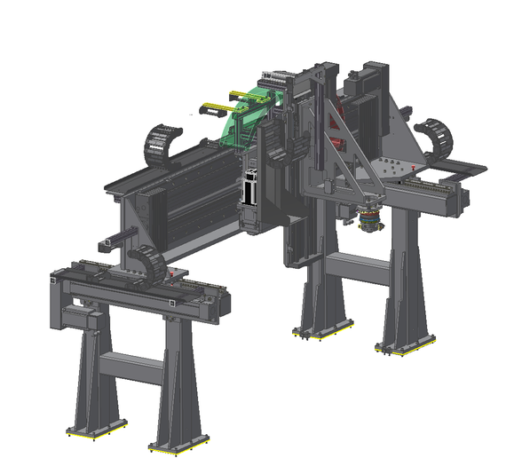](figures/jonas_review_m_regime/0804FC1588.png) | Multi-Achs-System (Gantry) | Die als „Portal / Gantry“ benannte Baugruppe besitzt eine beidseitig geführte Portalstruktur mit orthogonalen X/Y/Z-Linearachsen. Wird die Schwenkachse dem Endeffektor zugeordnet und nicht mitgezählt (R = 0, T = 3), erfüllt sie alle Kriterien für ein Multi-Achs-System bzw. Gantry. | 该装配体名为“Portal / Gantry”（龙门），具有双侧导向的龙门结构以及相互正交的 X/Y/Z 直线轴。如果将摆转轴归入末端执行器而不计入轴数（R = 0，T = 3），它便满足多轴系统（龙门）的全部判定条件。 | passed | — | — |
| 7 | 0804FC1588 |  | Kombinierte Einheit | Die Baugruppe „gantry“ 0804FC1588 wird in der Ground Truth und von allen Annotatoren als Gantry gelabelt. Allerdings ist die lineare Z-Achse auf einem Drehaktor aufgesetzt (in Zeichnung erkennbar), sodass es sich eindeutig um eine Kombinierte Einheit handelt. Sowohl Claude Opus 4-8 als auch Gemini 2.5 Pro haben dies im Lauf P3 (pdf) korrekt erkannt. | 装配体“gantry”0804FC1588 在 Ground Truth 中以及所有标注者的标注中均被归为龙门。然而，其直线 Z 轴安装在一个旋转执行器上（图纸中可见），因此它明确属于组合单元。Claude Opus 4-8 和 Gemini 2.5 Pro 均在 P3（pdf）运行中正确识别了这一点。 | passed | Grenze Endeffektor auslegbar | 末端执行器的边界存在解释空间。 |
| 8 | 0804FC1588 |  | Keine der verfügbaren Klassen | Auf Basis der 3D-Bilder wird die Baugruppe als SCHUNK-Schnellwechselsystem zum Koppeln und Verriegeln von Roboterwerkzeugen interpretiert; die Benennung „gantry / Portal“ wird durch die technischen Unterlagen dabei nicht bestätigt. Wird der pneumatische Antrieb nur der Verriegelungsmechanik zugeordnet (Hilfsfunktion nach Abschnitt 3) und liegt keine Greiffunktion vor (R = 0, T = 0), führt dies zu Keine der verfügbaren Klassen. | 根据 3D 图像，该装配体被解释为用于连接和锁紧机器人末端工具的 SCHUNK 快换系统；技术资料未能证实其“gantry / Portal”的名称。如果将气动驱动仅归入锁紧机构（第 3 节所述的辅助功能），且不存在夹持功能（R = 0，T = 0），则归为“不属于任何可用类别”。 | failed | — | — |
| 9 | 0804KZ9027 | [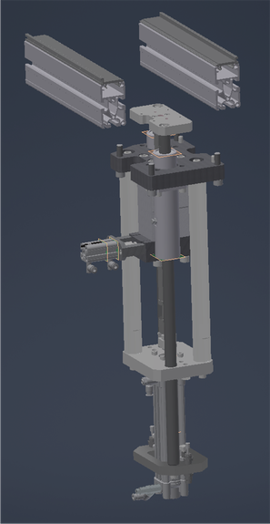](figures/jonas_review_m_regime/0804KZ9027.png) | Kombinierte Einheit | In der Baugruppe sind zwei orthogonal zueinander wirkende Pneumatikzylinder verbaut (vertikaler Hub 125 mm und horizontaler Schieberhub 20 mm). Werden beide Antriebe als Teil des Hauptbewegungsablaufs mitgezählt (R = 0, T = 2), sind die Gantry-Kriterien (Fall B) nicht erfüllt, sodass die Baugruppe als Umsetzeinheit / Kombinierte Einheit (Klasse 4) eingestuft wird. | 该装配体中安装了两个作用方向相互正交的气缸（竖直行程 125 mm，水平滑块行程 20 mm）。如果将两个驱动都计入主要运动过程（R = 0，T = 2），由于不满足龙门判定条件（情形 B），该装配体被归为移载单元／组合单元（第 4 类）。 | passed | Grenze Hilfsfunktion/Hauptfunktion auslegbar | 辅助功能与主要功能之间的界限存在解释空间。 |
| 10 | 0804KZ9027 |  | Lineareinheit | Die Hauptfunktion des Aushebers ist das rein vertikale Anheben des Werkstücks über einen Hubzylinder (T = 1). Da der zweite, horizontale Zylinder (∅16 / 20 mm Hub) nur einen internen Schieber zur mechanischen Verriegelung/Abstützung betätigt (Hilfsfunktion nach Abschnitt 3, nicht mitzuzählen), ergibt sich R = 0, T = 1 → Klasse 1 (Lineareinheit). | 该顶升装置的主要功能是通过升降气缸沿竖直方向抬升工件（T = 1）。第二个水平气缸（直径 16 mm／行程 20 mm）仅驱动内部滑块，实现机械锁紧／支撑（第 3 节所述的辅助功能，不计入轴数），因此 R = 0，T = 1 → 第 1 类（直线单元）。 | passed | — | — |
| 11 | 0804DT6452 | [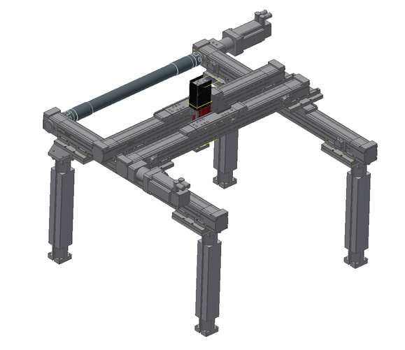](figures/jonas_review_m_regime/0804DT6452.png) | Multi-Achs-System (Gantry) | In der 3D-Ansicht ist ein vollständiges, beidseitig geführtes X/Y-Portal samt Motoren dargestellt und als „gantry / Portal“ benannt. Auf Basis des 3D-Modells (R = 0, T = 2) sind alle Gantry-Kriterien für Klasse 2 erfüllt. | 3D 视图中显示了一个包含电机、采用双侧导向的完整 X/Y 龙门，并将其命名为“gantry / Portal”。根据 3D 模型（R = 0，T = 2），它满足第 2 类的全部龙门判定条件。 | passed | — | — |
| 12 | 0804DT6452 |  | Keine der verfügbaren Klassen | In der 2D-Zeichnung sind die Achsen nur als Referenzgeometrie angedeutet, und die Stückliste enthält ausschließlich das passive Montagegestell aus Alu-Profilen und Blechen ohne Aktorik (R = 0, T = 0). Da ein reines Gestell weder Bewegungs- noch Greiffunktion besitzt, führt dies direkt zu Klasse 7. | 2D 图纸仅以参考几何示意这些轴，物料清单中则只有由铝型材和钣金件构成的被动安装机架，不包含驱动机构（R = 0，T = 0）。由于单纯的机架既不具备运动功能，也不具备夹持功能，因此直接归为第 7 类。 | passed | Funktionsgrenze in der BG: Es ist klar ein Multi-Achs-System von der Funktion her, aber aktoren sind beim Zuschnitt der Baugruppe abgeschnitten worden und Teil benachbarter Baugruppen | 装配体中的功能边界问题：从功能上看，这显然是一个多轴系统，但划分装配体范围时，执行器被划到了当前装配体之外，属于相邻装配体。 |
| 13 | 0804JL8434 | [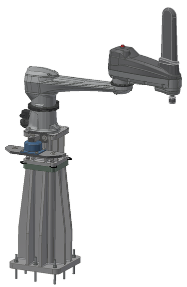](figures/jonas_review_m_regime/0804JL8434.png) | Roboter | Nach Regelwerk klar KE, aber nach gelebter Praxis / Funktionsweise eindeutig ein Roboter | 按照规则明确属于组合单元（KE），但按照实际应用惯例／工作方式，显然是一台机器人。 | passed | Regelwerk modelliert Roboter zu oberflächlich, zudem kann Achse als Endeffektor gewertet werden. | 规则对机器人的描述过于粗略，此外，该轴也可以被视为末端执行器的一部分。 |
| 14 | 0804JL8434 |  | Kombinierte Einheit | Der Roboter verfügt neben den Rotationsachsen zusätzlich über eine Linearachse (R ≥ 2, T ≥ 1). Nach der Entscheidungstabelle im Codebook führt diese Kombination aus Rotations- und Translationsachsen zwingend zu Klasse 4. | 该机器人除旋转轴之外，还具有一个直线轴（R ≥ 2，T ≥ 1）。根据 Codebook 中的决策表，这种旋转轴与平移轴的组合必须归为第 4 类。 | passed | — | — |
| 15 | 0804KB2225 | [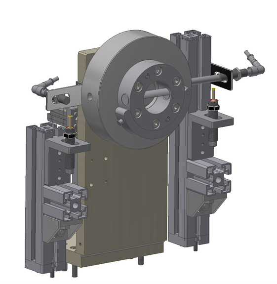](figures/jonas_review_m_regime/0804KB2225.png) | Rotationseinheit | Die Baugruppe heißt „Rotationseinheit“ und ermöglicht über eine gelagerte Welle mit Endlagendämpfern eine definierte Schwenkbewegung um eine Drehachse. Orientiert man sich an dieser konstruktiven Drehbankfunktion bzw. setzt einen Antrieb voraus (R = 1, T = 0), ergibt sich Klasse 6. | 该装配体名为“Rotationseinheit”（旋转单元），通过带支承的轴和终端缓冲器，实现绕一个旋转轴的确定摆转运动。如果依据其结构所体现的车床旋转功能，或假定存在驱动（R = 1，T = 0），则归为第 6 类。 | passed | Klar Drehfunktion, aber Aktor ausgelagert | 明显具有旋转功能，但执行器被划分在当前装配体之外。 |
| 16 | 0804KB2225 |  | Keine der verfügbaren Klassen | Baugruppe unterbestimmt, Rotation zwar in zeichnung erkennbar aber kein Aktor erkennbar | 该装配体的信息不足以唯一确定类别：虽然图纸中可以看出旋转运动，但看不到执行器。 | passed | — | — |
| 17 | 0804KB2225 |  | Kombinierte Einheit | Nur von einem menschlichen Annotator markiert; im Ausgangsblatt ist keine Begründung hinterlegt und die Klasse wurde von keinem LLM vergeben. | 仅由一名人工标注者选中；原始工作表未记录理由，也没有任何 LLM 给出该类别。 | failed | — | — |
| 18 | 0804JU56371 | [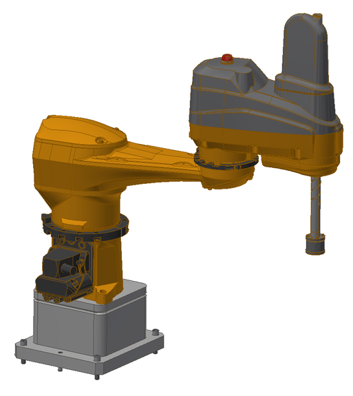](figures/jonas_review_m_regime/0804JU56371.png) | Roboter | Nach Regelwerk klar KE, aber nach gelebter Praxis / Funktionsweise eindeutig ein Roboter | 按照规则明确属于组合单元（KE），但按照实际应用惯例／工作方式，显然是一台机器人。 | passed | — | — |
| 19 | 0804JU56371 |  | Kombinierte Einheit | Der Roboter verfügt neben den Rotationsachsen zusätzlich über eine Linearachse (R ≥ 2, T ≥ 1). Nach der Entscheidungstabelle im Codebook führt diese Kombination aus Rotations- und Translationsachsen zwingend zu Klasse 4. | 该机器人除旋转轴之外，还具有一个直线轴（R ≥ 2，T ≥ 1）。根据 Codebook 中的决策表，这种旋转轴与平移轴的组合必须归为第 4 类。 | passed | — | — |
| 20 | 0804EU0861 | [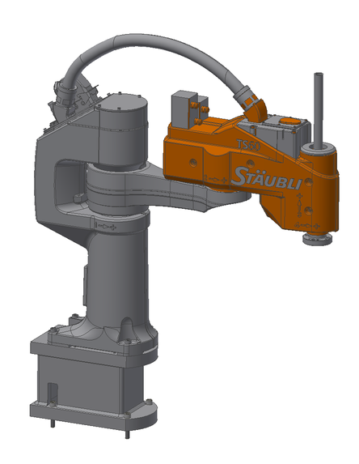](figures/jonas_review_m_regime/0804EU0861.png) | Roboter | Nach Regelwerk klar KE, aber nach gelebter Praxis / Funktionsweise eindeutig ein Roboter | 按照规则明确属于组合单元（KE），但按照实际应用惯例／工作方式，显然是一台机器人。 | passed | — | — |
| 21 | 0804EU0861 |  | Kombinierte Einheit | Der Roboter verfügt neben den Rotationsachsen zusätzlich über eine Linearachse (R ≥ 2, T ≥ 1). Nach der Entscheidungstabelle im Codebook führt diese Kombination aus Rotations- und Translationsachsen zwingend zu Klasse 4. | 该机器人除旋转轴之外，还具有一个直线轴（R ≥ 2，T ≥ 1）。根据 Codebook 中的决策表，这种旋转轴与平移轴的组合必须归为第 4 类。 | passed | — | — |
| 22 | 0804EU0861 |  | Keine der verfügbaren Klassen | Auf Basis der reinen Text-Eingabe enthält die Stückliste keine angetriebene Roboterkinematik, sondern lediglich eine Konsole bzw. ein Schweißteil für einen Stäubli TS60 sowie Befestigungsschrauben. Wird die Baugruppe daher als statische Montage-/Adapterbaugruppe ohne eigenständige Handhabungsbewegung und ohne Greiffunktion gewertet (R = 0, T = 0), ergibt sich Keine der verfügbaren Klassen. | 仅根据纯文本输入，物料清单中不包含带驱动的机器人运动机构，只有用于 Stäubli TS60 的支架或焊接件，以及紧固螺钉。因此，如果将其视为不具备独立操作运动且没有夹持功能的静态安装／转接装配体（R = 0，T = 0），则归为“不属于任何可用类别”。 | failed | — | — |
| 23 | 0804GE7738 | [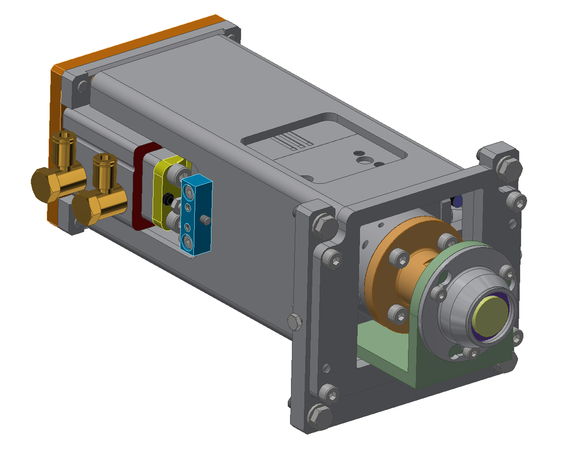](figures/jonas_review_m_regime/0804GE7738.png) | Rotationseinheit | Die Baugruppe ist als „Rotationseinheit für 360°-Drehung der Prüflinge“ benannt, und da das Gehäuse die interne Mechanik im 3D-Modell verdeckt, scheint nur eine reine Drehbewegung vorzuliegen (R = 1, T = 0). Auf Basis der Benennung und der von außen erkennbaren Hauptfunktion führt dies zur Einstufung als Rotationseinheit. | 该装配体名为“用于被测件 360° 旋转的旋转单元”；由于壳体在 3D 模型中遮挡了内部机构，看起来似乎只有纯旋转运动（R = 1，T = 0）。根据名称及外部可见的主要功能，它被归为旋转单元。 | passed | Je nachdem ob Lineareinheit als Auswerfer interpretiert wird | 取决于是否将直线单元解释为顶出机构。 |
| 24 | 0804GE7738 |  | Kombinierte Einheit | Laut Stückliste und 2D-Zeichnung sind im Inneren des Gehäuses sowohl eine elektrische Schunk-Dreheinheit als auch ein vertikaler Pneumatikzylinder für 5 mm Hub verbaut (R = 1, T = 1). Durch diese Kombination aus Rotation und Translation zum Anheben und Drehen des Prüflings gehört die Baugruppe nach Codebook zur Kombinierten Einheit. | 根据物料清单和 2D 图纸，壳体内部同时安装了电动 Schunk 旋转单元和竖直气缸，后者行程为 5 mm（R = 1，T = 1）。由于该装配体通过旋转与平移的组合实现被测件的抬升和旋转，按照 Codebook 应归为组合单元。 | passed | — | — |
| 25 | 0804GE7738 |  | Lineareinheit | Wird die Baugruppe anhand der Bilder als pneumatischer Führungszylinder (AVENTICS GPC-BV) mit doppeltwirkendem Hub von 10 mm interpretiert, liegt genau eine translatorische Achse vor; die Führungsstangen dienen nur der Verdrehsicherung und Querkraftaufnahme. Ohne rotatorischen Antrieb und ohne Greifvorrichtung (R = 0, T = 1) führt die Entscheidungsmatrix – entgegen der Benennung als Rotationseinheit – zur Lineareinheit. | 如果根据图像将该装配体解释为具有 10 mm 双作用行程的气动导向气缸（AVENTICS GPC-BV），则恰好存在一个平移轴；导向杆仅用于防转和承受横向力。在没有旋转驱动及夹持装置的情况下（R = 0，T = 1），决策矩阵将其归为直线单元，尽管其名称为旋转单元。 | failed | — | — |
| 26 | 0804LB1151 | [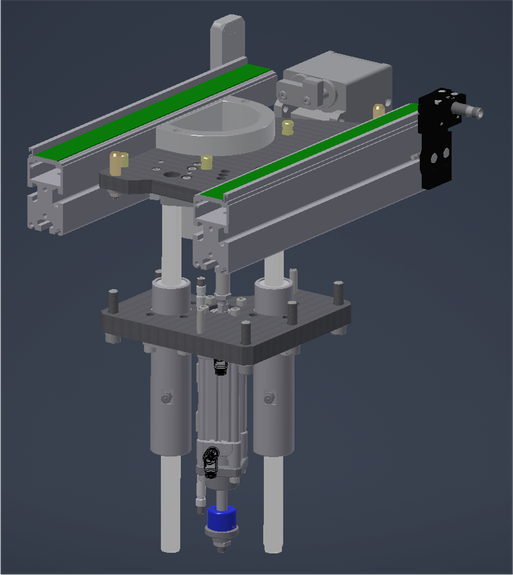](figures/jonas_review_m_regime/0804LB1151.png) | Lineareinheit | Die Hauptfunktion des Aushebers ist das vertikale Anheben des Werkstückträgers über den Pneumatikzylinder mit 50 mm Hub. Wird die zweite Komponente als Auswerfer bzw. Hilfsfunktion oder als manuelle X/Y-Verstellachse über die Stellplatte gewertet (R = 0, T = 1), ist die Baugruppe eindeutig eine Lineareinheit. | 该顶升装置的主要功能是通过行程为 50 mm 的气缸，沿竖直方向抬升工件托盘。如果将第二个部件视为顶出机构／辅助功能，或通过调整板实现的手动 X/Y 调整轴（R = 0，T = 1），则该装配体明确属于直线单元。 | passed | — | — |
| 27 | 0804LB1151 |  | Multi-Achs-System (Gantry) | Neben dem vertikalen Hubzylinder deuten die Unterbaugruppen Bauelemente sowie die mehrstufigen Hubangaben und Verstellachsen in der Zeichnung auf einen zweiten translatorischen Aktor hin, dessen genaue Funktion durch fehlende 3D-Ansichten unterbestimmt bleibt. Werden beide Antriebe als Prozessachsen gezählt (R = 0, T = 2) und fehlt der horizontale X/Y-Arbeitsraum, handelt es sich um eine Kombinierte Einheit. | 除竖直升降气缸外，子装配体“Bauelemente”以及图纸中的多级行程标注和调整轴，都暗示存在第二个平移执行器；由于缺少 3D 视图，其具体功能仍无法唯一确定。如果将两个驱动都计为过程轴（R = 0，T = 2），且不存在水平 X/Y 工作空间，则属于组合单元。 | failed | Zweiter Aktor nicht teil der Baugruppe. Unsauberkeit in CAD-Modelle | 第二个执行器不属于该装配体。CAD 模型存在不规范之处。 |
| 28 | 0804LB1151 |  | Kombinierte Einheit | In der Draufsicht sind zwei orthogonale horizontale Verstellbereiche (± 2,5 mm und ± 1 mm) zusammen mit der beidseitig über zwei Linearführungen geführten Vertikalachse dargestellt. Werden diese horizontalen Achsen mangels 3D-Modell fälschlicherweise als motorische Prozessachsen interpretiert (R = 0, T ≥ 2), entsteht der Eindruck eines kartesischen Multi-Achs-Systems bzw. Gantrys. | 俯视图显示了两个相互正交的水平调整范围（± 2.5 mm 和 ± 1 mm），以及由两条直线导轨实现双侧导向的竖直轴。如果由于缺少 3D 模型而错误地将这些水平轴解释为电机驱动的过程轴（R = 0，T ≥ 2），就会产生笛卡尔多轴系统或龙门系统的印象。 | failed | Zweiter Aktor nicht teil der Baugruppe. Unsauberkeit in CAD-Modelle | 第二个执行器不属于该装配体。CAD 模型存在不规范之处。 |
| 29 | 0804GY2576 | [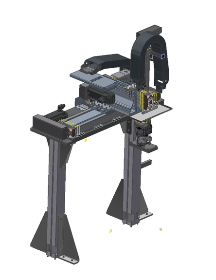](figures/jonas_review_m_regime/0804GY2576.png) | Kombinierte Einheit | Trotz drei orthogonaler Linearachsen (R = 0, T = 3) kragt die zweite Horizontalachse einseitig aus und wird nicht an beiden Enden geführt. Da das dritte Gantry-Kriterium somit streng genommen fehlt, ist es eine Kombinierte Einheit. | 尽管存在三个相互正交的直线轴（R = 0，T = 3），第二个水平轴仍为单侧悬臂式结构，并未在两端均设置导向。因此，严格来说缺少第三项龙门判定条件，应归为组合单元。 | passed | — | — |
| 30 | 0804GY2576 |  | Multi-Achs-System (Gantry) | Die als „Portal“ benannte Baugruppe besitzt drei orthogonale Linearachsen (R = 0, T = 3), wobei die erste Achse über ein breites Rexroth-Hauptmodul mit zwei parallelen Führungsschienen verfügt. Wird diese Doppelführung als beidseitige Führung gewertet, ist die Zuordnung als Multi-Achs-System vertretbar. | 该装配体名为“Portal”（龙门），具有三个相互正交的直线轴（R = 0，T = 3）；其第一轴采用较宽的 Rexroth 主模块，包含两条平行导轨。如果将这种双导轨结构视为双侧导向，则归为多轴系统是合理的。 | passed | — | — |
| 31 | 0804AR3766 | [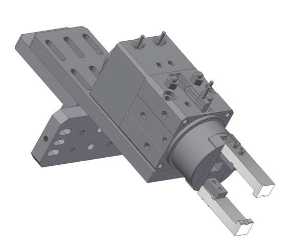](figures/jonas_review_m_regime/0804AR3766.png) | Rotationseinheit | Die Baugruppe heißt „Rotationseinheit“ und nutzt eine SMC-Greiferdreheinheit für eine 90°-Schwenkbewegung des Werkstücks. Zählt man den Drehantrieb als Hauptbewegungsaktor und lässt nur den Greifhub weg (R = 1, T = 0), ist es eine Rotationseinheit. | 该装配体名为“Rotationseinheit”（旋转单元），利用 SMC 旋转夹爪单元实现工件的 90° 摆转。如果将旋转驱动计为主要运动执行器，仅排除夹持行程（R = 1，T = 0），则属于旋转单元。 | passed | — | — |
| 32 | 0804AR3766 |  | Greifer | Da Dreh- und Greifaktor in einem kompakten Zukauf-Drehgreifer integriert sind, kann die gesamte Einheit als Endeffektor zum Greifen des Werkstücks betrachtet werden. Werden nach Codebook alle Aktoren innerhalb des Greifers nicht mitgezählt (R = 0, T = 0), führt dies zur Einstufung als Greifer. | 由于旋转执行器和夹持执行器集成在一个紧凑的外购旋转夹爪中，可以将整个单元视为用于夹持工件的末端执行器。如果按照 Codebook 不计入夹爪内部的所有执行器（R = 0，T = 0），则归为夹爪。 | passed | — | — |
| 33 | 0804AR3766 |  | Kombinierte Einheit | Laut Stückliste (Pos. 0100) ist die zentrale Funktionskomponente eine SMC-Greiferdreheinheit (MRHQ16D-90S), die eine Drehbewegung von 90° mit einem 2-Finger-Greifer (Hub 3 mm pro Finger) vereint. Werden Drehung und Greiffunktion gemeinsam als Hauptfunktionen gezählt (R = 1, T = 0 zzgl. Greifen) und Platten bzw. Haltearm als reine Adapterteile betrachtet, handelt es sich um eine Kombinierte Einheit. | 根据物料清单（位置号 0100），核心功能部件为 SMC 旋转夹爪单元（MRHQ16D-90S），集成了 90° 旋转运动和双指夹爪（每个夹指行程 3 mm）。如果将旋转与夹持共同计为主要功能（R = 1，T = 0，另加夹持功能），并将板件和支臂视为纯转接件，则属于组合单元。 | failed | — | — |
| 34 | 0804KV4964 | [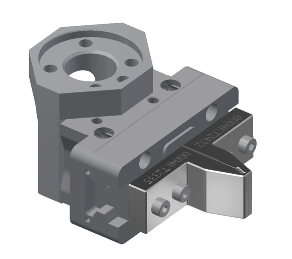](figures/jonas_review_m_regime/0804KV4964.png) | Greifer | Die Baugruppe heißt „Greifereinheit“, und laut DFC-Eintrag sowie Datenblatt handelt es sich um einen pneumatischen 2-Backen-Parallelgreifer zum Greifen eines Drahts (R = 0, T = 0). Auf Basis des vollständigen Greifers ist die Einstufung als Greifer eindeutig. | 该装配体名为“Greifereinheit”（夹爪单元）；根据 DFC 条目和数据表，它是用于夹持金属丝的气动双爪平行夹爪（R = 0，T = 0）。从完整夹爪来看，归为夹爪是明确的。 | passed | — | — |
| 35 | 0804KV4964 |  | Keine der verfügbaren Klassen | In der 2D-Zeichnung ist der Grundkörper des Parallelgreifers nur als Strich-Zweipunkt-Referenzlinie angedeutet, sodass die Baugruppe ausschließlich die zwei passiven Greifbacken umfasst (R = 0, T = 0). Da einzelne Finger ohne den Greiferaktor selbst keine Greifbewegung ausführen können, fällt dies unter Keine der verfügbaren Klassen. | 2D 图纸中仅以双点划参考线示意平行夹爪的基体，因此该装配体仅包含两个被动夹爪指（R = 0，T = 0）。由于单独的夹指没有夹爪执行器便无法自行执行夹持运动，因此归为“不属于任何可用类别”。 | passed | — | — |
| 36 | 0804JK8878 | [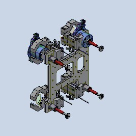](figures/jonas_review_m_regime/0804JK8878.png) | Greifer | Die Baugruppe ist ein Vierfach-Greifer mit vier auf einer Trägerplatte montierten Greifereinheiten. Da die internen Linearzylinder implizit als Auswerfer bzw. Hilfsfunktion innerhalb der Greifköpfe dienen und somit nicht mitgezählt werden (R = 0, T = 0), wird sie als Greifer eingestuft. | 该装配体为四联夹爪，包含安装在一块承载板上的四个夹爪单元。内部直线气缸可隐含地理解为夹持头内部的顶出机构或辅助功能，因此不计入轴数（R = 0，T = 0），该装配体被归为夹爪。 | passed | — | — |
| 37 | 0804JK8878 |  | Lineareinheit | Zuordnung als LE vertretbar, da alle greifköpfe linear bewegt werden. Es ist zwar implizit, dass das für eine Auswerffunktion geschieht, aber nicht explizit | 归为直线单元（LE）是合理的，因为所有夹持头都会作直线运动。虽然可以隐含推断这些运动是为了实现顶出功能，但资料并未明确说明。 | failed | — | — |
| 38 | 0804KX4663 | [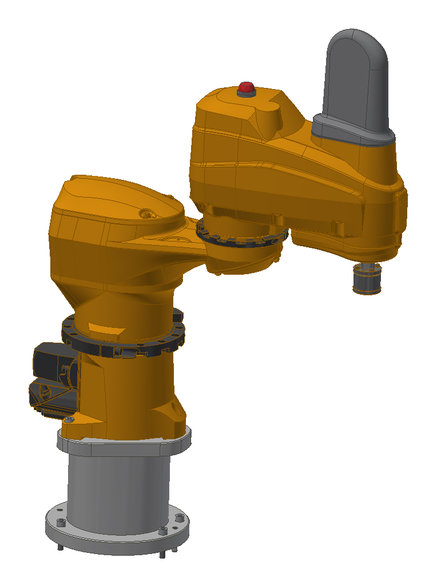](figures/jonas_review_m_regime/0804KX4663.png) | Roboter | Nach Regelwerk klar KE, aber nach gelebter Praxis / Funktionsweise eindeutig ein Roboter | 按照规则明确属于组合单元（KE），但按照实际应用惯例／工作方式，显然是一台机器人。 | passed | — | — |
| 39 | 0804KX4663 |  | Kombinierte Einheit | Der Roboter verfügt neben den Rotationsachsen zusätzlich über eine Linearachse (R ≥ 2, T ≥ 1). Nach der Entscheidungstabelle im Codebook führt diese Kombination aus Rotations- und Translationsachsen zwingend zu Klasse 4. | 该机器人除旋转轴之外，还具有一个直线轴（R ≥ 2，T ≥ 1）。根据 Codebook 中的决策表，这种旋转轴与平移轴的组合必须归为第 4 类。 | passed | — | — |
| 40 | 0804JX5476 | [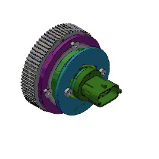](figures/jonas_review_m_regime/0804JX5476.png) | Rotationseinheit | Die Baugruppe heißt „Rotationseinheit“ und bildet mit Rillenkugellager, Riemenscheibe und Aufnahmehalterung eine drehbare Werkstückaufnahme um genau eine Achse. Orientiert man sich an dieser eindeutigen Hauptfunktion zum Drehen des Bauteils (R = 1, T = 0), wird sie als Rotationseinheit eingestuft. | 该装配体名为“Rotationseinheit”（旋转单元），通过深沟球轴承、带轮和工件安装支架，构成可绕单一轴旋转的工件承载机构。如果依据这一明确的工件旋转主功能（R = 1，T = 0），则归为旋转单元。 | passed | Mehrdeutig, da aktor nicht teil der Baugruppe | 由于执行器不属于该装配体，因此存在分类歧义。 |
| 41 | 0804JX5476 |  | Keine der verfügbaren Klassen | Obwohl die Drehbewegung über die Riemenscheibe vorgesehen ist, ist der antreibende Motor nicht Teil dieser Baugruppe, sodass laut Stückliste kein Aktor vorliegt (R = 0, T = 0). Da auch keine Greiffunktion existiert, führt die strenge Aktorzählung nach Codebook zu Keine der verfügbaren Klassen. | 虽然设计上通过带轮实现旋转运动，但驱动电机不属于该装配体，因此根据物料清单不存在执行器（R = 0，T = 0）。由于也没有夹持功能，按照 Codebook 严格统计执行器后，应归为“不属于任何可用类别”。 | passed | — | — |
| 42 | 0804KV0861 | [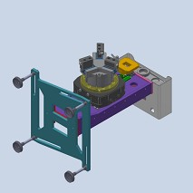](figures/jonas_review_m_regime/0804KV0861.png) | Greifer | Die Baugruppe heißt „Greifereinheit“ und besteht aus Sauggreifer, Vakuum-Ejektor, Greiferfingern sowie Visionsystem an einem Roboterflansch. Werden sämtliche integrierten Antriebe als Teil des Endeffektors nicht mitgezählt (R = 0, T = 0), ist sie eindeutig ein Greifer. | 该装配体名为“Greifereinheit”（夹爪单元），由机器人法兰上的真空吸盘、真空发生器、夹指以及视觉系统构成。如果将所有集成驱动都视为末端执行器的一部分而不计入轴数（R = 0，T = 0），则明确属于夹爪。 | passed | — | — |
| 43 | 0804KV0861 |  | Rotationseinheit | Am Flansch der Aufspannvorrichtung ist eine rotatorische Schwenk- bzw. Ausrichtfunktion integriert. Wird dieser Drehantrieb als eigenständiger Prozessaktor gezählt und die Greif- bzw. Schubbewegung dem Endeffektor zugeordnet (R = 1, T = 0), ergibt sich eine Rotationseinheit. | 装夹装置的法兰处集成了旋转摆动或对准功能。如果将该旋转驱动计为独立过程执行器，并将夹持或推移运动归入末端执行器（R = 1，T = 0），则归为旋转单元。 | failed | Das ist kein Rotationsaktor, sondern eine Ausgleichseinheit | 这不是旋转执行器，而是一个补偿单元。 |
| 44 | 0804KV0861 |  | Kombinierte Einheit | Die als „gripper unit / Greifereinheit“ benannte Baugruppe vereint laut Stückliste mechanische Greiferfinger (Pos. 0005), Vakuum-Sauggreifer (Pos. 0002) mit Ejektor und Vakuumschalter sowie ein Visionsystem (Pos. 0003). Wird diese Kombination unterschiedlicher Funktionsprinzipien als mehrere eigenständige Handhabungsfunktionen gewertet, ergibt sich die Einstufung als Kombinierte Einheit. | 根据物料清单，该装配体名为“gripper unit / Greifereinheit”（夹爪单元），集成了机械夹指（位置号 0005）、配有真空发生器和真空开关的真空吸盘（位置号 0002），以及视觉系统（位置号 0003）。如果将这些不同功能原理的组合视为多个独立的操作功能，则归为组合单元。 | failed | — | — |
| 45 | 0804HK2005 | [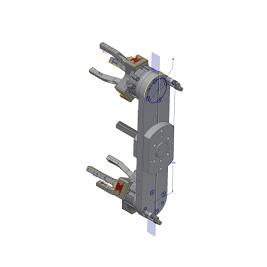](figures/jonas_review_m_regime/0804HK2005.png) | Greifer | Die Baugruppe heißt „Greifereinheit“ und besteht aus zwei Parallelgreifern an einer gemeinsamen Brücke, während für die zentrale Drehachse kein eigener Antriebsaktor enthalten ist (R = 0, T = 0). Da Greifaktoren nicht mitzählen und kein Drehaktor vorliegt, wird sie als Doppelgreifer der Klasse Greifer zugeordnet. | 该装配体名为“Greifereinheit”（夹爪单元），由同一桥架上的两个平行夹爪构成，但不包含中央旋转轴的独立驱动执行器（R = 0，T = 0）。由于夹持执行器不计入轴数，且不存在旋转执行器，因此作为双夹爪归入夹爪类别。 | passed | — | — |
| 46 | 0804HK2005 |  | Rotationseinheit | In der Mitte der Trägerbrücke befindet sich eine zentrale Welle mit Drehflansch, um die beiden äußeren Greifer um eine Achse zu schwenken. Orientiert man sich an dieser übergeordneten Schwenkfunktion bzw. setzt den zugehörigen Drehantrieb voraus (R = 1, T = 0), ergibt sich eine Rotationseinheit. | 承载桥架中央有一根带旋转法兰的中心轴，用于使两侧夹爪绕一个轴摆转。如果依据这一整体摆转功能，或假定存在相应旋转驱动（R = 1，T = 0），则归为旋转单元。 | failed | — | — |
| 47 | 0804HK2005 |  | Kombinierte Einheit | Die Baugruppe besteht aus einer zentralen Trägerplatte mit zwei identischen Greifereinheiten, die jeweils auf einer drehbaren Plattform montiert sind. Wird die Drehbewegung (R = 1 je Greifer) zusammen mit der Greiffunktion als Hauptbewegungsablauf zum Aufnehmen und Wenden bzw. Orientieren der Werkstücke gezählt, handelt es sich um eine Kombinierte Einheit. | 该装配体由中央承载板和两个相同的夹爪单元组成，每个夹爪单元均安装在可旋转的平台上。如果将旋转运动（每个夹爪 R = 1）和夹持功能共同计为拾取、翻转或调整工件姿态的主要运动过程，则属于组合单元。 | failed | — | — |
| 48 | 0804KY7178 | [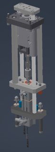](figures/jonas_review_m_regime/0804KY7178.png) | Lineareinheit | Die Hauptfunktion des Aushebers ist das vertikale Anheben über den Hauptzylinder, während der horizontale Kompaktzylinder laut Schnitt A-A lediglich einen Schieber zur internen mechanischen Verriegelung der Hubwelle betätigt. Da diese Verriegelung als Hilfsfunktion nicht mitzählt (R = 0, T = 1), handelt es sich um eine Lineareinheit. | 该顶升装置的主要功能是通过主气缸实现竖直抬升；根据 A-A 剖视图，水平紧凑型气缸仅驱动一个滑块，用于升降轴内部的机械锁紧。由于这一锁紧功能属于辅助功能，不计入轴数（R = 0，T = 1），因此属于直线单元。 | passed | — | — |
| 49 | 0804KY7178 |  | Kombinierte Einheit | Neben dem vertikalen Hubzylinder besitzt die Baugruppe einen orthogonal angeordneten zweiten Pneumatikzylinder, dessen betätigtes Bauteil in der Stückliste als „pusher / Schieber“ benannt ist. Wird dieser aufgrund der Benennung und Anordnung als zweite aktive Linearachse gewertet (R = 0, T = 2), führt dies zur Einstufung als Kombinierte Einheit. | 除竖直升降气缸外，该装配体还具有一个与其正交布置的第二气缸，其驱动部件在物料清单中名为“pusher / Schieber”（推杆／滑块）。如果根据名称和布置将其视为第二个主动直线轴（R = 0，T = 2），则归为组合单元。 | passed | Abh. davon, ob Auswerfer zur Kernfunktion gezählt wird | 取决于是否将顶出机构计入核心功能。 |
| 50 | 0804CM8667 | [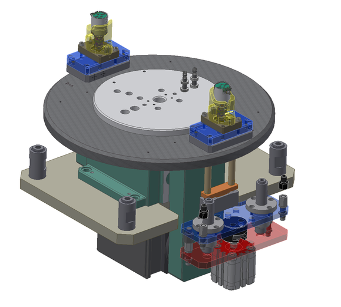](figures/jonas_review_m_regime/0804CM8667.png) | Rotationseinheit | Die Baugruppe heißt „Rotationseinheit“ und besteht im Kern aus einem Weiss-Rundschalttisch mit zwei Werkstückaufnahmen. Wird die unterhalb des Tisches montierte Hubeinrichtung lediglich als Auswerfer bzw. Hilfsfunktion gewertet und nicht mitgezählt (R = 1, T = 0), handelt es sich um eine Rotationseinheit. | 该装配体名为“Rotationseinheit”（旋转单元），核心为配有两个工件承载座的 Weiss 旋转分度台。如果将安装在转台下方的升降装置仅视为顶出机构或辅助功能而不计入轴数（R = 1，T = 0），则属于旋转单元。 | passed | — | — |
| 51 | 0804CM8667 |  | Kombinierte Einheit | Neben dem Rundschalttisch enthält die Baugruppe eine pneumatische Hubeinrichtung, die von unten auf die Hubeinheiten am Drehteller wirkt. Wird dieser vertikale Hub als relevanter Teil des Hauptbewegungsablaufs gezählt (R = 1, T = 1), führt die Kombination aus Rotation und Translation zur Einstufung als Kombinierte Einheit. | 除旋转分度台外，该装配体还包含气动升降装置，从下方作用于转盘上的升降单元。如果将该竖直升降计为主要运动过程的相关部分（R = 1，T = 1），则旋转和平移的组合使其归为组合单元。 | passed | — | — |
| 52 | 0804CM8667 |  | Lineareinheit | Die Stückliste weist eine Hubeinrichtung („lifting device / lifting unit“) mit Festo-Kompaktzylindern (ADVU/AEVU) als aktive Antriebe für eine translatorische Bewegung aus (T = 1). Da für die Drehbewegung kein expliziter rotatorischer Antrieb (Motor, Schwenkantrieb) in den Dokumenten genannt ist, wird nach Prioritätsregel 2 keine Rotationsachse gezählt (R = 0), sodass sich trotz der Benennung „Rotationseinheit“ eine Lineareinheit ergibt. | 物料清单列出了配有 Festo 紧凑型气缸（ADVU/AEVU）的升降装置（“lifting device / lifting unit”），作为实现平移运动的主动驱动（T = 1）。由于资料中没有明确列出旋转运动的驱动装置（电机、摆转驱动），根据优先规则 2 不计入旋转轴（R = 0），因此尽管名称为“旋转单元”，仍归为直线单元。 | failed | — | — |
| 53 | 0804LK3617 | [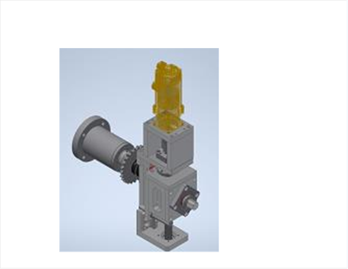](figures/jonas_review_m_regime/0804LK3617.png) | Rotationseinheit | Die Baugruppe heißt „Dreheinheit“ und ist über eine horizontal gelagerte Welle mit Kettennuss als Ganzes drehbar gelagert. Orientiert man sich an dieser übergeordneten Drehbewegung der Gesamteinheit (R = 1, T = 0), ist die Einstufung als Rotationseinheit vertretbar. | 该装配体名为“Dreheinheit”（旋转单元），通过一根水平支承、带链轮的轴实现整体可旋转支承。如果依据整个单元的这一整体旋转运动（R = 1，T = 0），则归为旋转单元是合理的。 | failed | Es ist auf jeden fall eine Linearaktorik für den Haupt-Bewegungsablauf verbaut | 可以确定，装配体中安装了用于主要运动过程的直线驱动机构。 |
| 54 | 0804LK3617 |  | Kombinierte Einheit | Die Baugruppe kombiniert eine vertikale Linearachse aus Getriebemotor und Kugelgewindetrieb mit einer horizontalen Drehachse samt Kettenrad. Wird die über das Kettenrad angetriebene Drehachse neben dem verbauten Linearaktor mitgezählt (R = 1, T = 1), ergibt sich eine Kombinierte Einheit. | 该装配体将由减速电机和滚珠丝杠传动构成的竖直直线轴，与配有链轮的水平旋转轴相结合。如果除已安装的直线执行器外，也将通过链轮驱动的旋转轴计入轴数（R = 1，T = 1），则归为组合单元。 | passed | — | — |
| 55 | 0804LK3617 |  | Lineareinheit | Laut Stückliste treibt ein Getriebemotor (Pos. 0104) einen Kugelgewindetrieb (Pos. 0113) an und erzeugt damit eine translatorische Achse (T = 1). Für die sichtbare Rotationsmechanik (Kettennuss, Pos. 0109) ist kein eigener Antrieb aufgeführt; wird die Drehung daher nach der Textprioritätsregel nicht mitgezählt (R = 0), wird die als „Dreheinheit“ benannte Baugruppe als Lineareinheit eingestuft. | 根据物料清单，减速电机（位置号 0104）驱动滚珠丝杠传动（位置号 0113），由此形成一个平移轴（T = 1）。对于可见的旋转机构（链轮，位置号 0109），清单未列出独立驱动；因此，如果依据文本优先规则不计入该旋转运动（R = 0），则将名为“Dreheinheit”（旋转单元）的装配体归为直线单元。 | passed | — | — |
| 56 | 0804MB2849 | [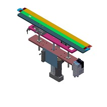](figures/jonas_review_m_regime/0804MB2849.png) | Lineareinheit | Die Baugruppe heißt „Hubeinheit“ und wird im 3D-Modell optisch vom großen vertikalen Elektrozylinder dominiert, während die kleine horizontale Schlitteneinheit unter der oberen Aufnahme kaum sichtbar ist. Wird nur der vertikale Hub wahrgenommen bzw. der zweite Zylinder übersehen (R = 0, T = 1), führt dies zur Einstufung als Lineareinheit. | 该装配体名为“Hubeinheit”（升降单元），3D 模型在视觉上主要呈现大型竖直电动缸，而上部承载座下方的小型水平滑台单元几乎不可见。如果只注意到竖直升降，或忽略第二个缸（R = 0，T = 1），则归为直线单元。 | failed | Beide aktoren sind klar an der Bewegung beteiligt | 两个执行器显然都参与了运动。 |
| 57 | 0804MB2849 |  | Kombinierte Einheit | Laut DFC-Stückliste und Zeichnung Blatt 2 besitzt die Baugruppe neben dem vertikalen Elektrozylinder mit 130 mm Hub zusätzlich eine horizontale pneumatische Mini-Schlitteneinheit samt Führungsschiene für 13 mm Querhub (R = 0, T = 2). Da zwei orthogonale Linearachsen ohne Gantry-Struktur kombiniert werden, handelt es sich tatsächlich um eine Kombinierte Einheit. | 根据 DFC 物料清单和图纸第 2 张，该装配体除行程为 130 mm 的竖直电动缸外，还包含一个带导轨的水平气动微型滑台单元，用于实现 13 mm 的横向行程（R = 0，T = 2）。由于组合了两个相互正交的直线轴，但不具有龙门结构，因此实际上属于组合单元。 | passed | — | — |
| 58 | 0804KU1528 | [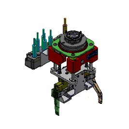](figures/jonas_review_m_regime/0804KU1528.png) | Greifer | Die Baugruppe heißt „Greifereinheit“ und dient als Palettiergreifer für PCBA, wobei die Greifbacken über Druckfedern auf einer Linearführung offenbar passiv ohne eigenen Prozessaktor gelagert sind (R = 0, T = 0). Da die Hauptfunktion das Greifen ist, wird sie als Greifer eingestuft. | 该装配体名为“Greifereinheit”（夹爪单元），用作 PCBA 的码垛夹爪；夹爪通过压缩弹簧支承在直线导轨上，显然为被动结构，没有独立的过程执行器（R = 0，T = 0）。由于主要功能是夹持，因此归为夹爪。 | passed | — | — |
| 59 | 0804KU1528 |  | Lineareinheit | Im 3D-Modell sind eine profilierte Linearführung, gefederte Schlitten sowie Druckluftanschlüsse am Schnellwechseladapter sichtbar, während die Unterstückliste des Greifers nicht vorliegt. Wird diese lineare Verschiebeachse aufgrund der unklaren Informationslage als aktiver pneumatischer Linearantrieb interpretiert (R = 0, T = 1), ergibt sich eine Lineareinheit. | 3D 模型中可以看到型材直线导轨、弹簧支承的滑块，以及快换适配器上的压缩空气接口，但没有夹爪的下级物料清单。如果由于信息不明确而将该直线移动轴解释为主动气动直线驱动（R = 0，T = 1），则归为直线单元。 | failed | — | — |
| 60 | 0804KU1528 |  | Kombinierte Einheit | Nur von einem menschlichen Annotator markiert; im Ausgangsblatt ist keine Begründung hinterlegt und die Klasse wurde von keinem LLM vergeben. | 仅由一名人工标注者选中；原始工作表未记录理由，也没有任何 LLM 给出该类别。 | failed | — | — |
| 61 | 0804LR0554 | [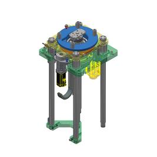](figures/jonas_review_m_regime/0804LR0554.png) | Lineareinheit | Die Baugruppe ist in der Zeichnung als „Lineareinheit“ und im DFC als „Hubeinheit“ benannt und wird optisch durch die vier langen Führungsstangen mit Kugelgewindespindel für 655 mm Hub dominiert. Orientiert man sich an dieser Benennung und der primär sichtbaren Hubbewegung (R = 0, T = 1), wird sie als Lineareinheit eingestuft. | 该装配体在图纸中名为“Lineareinheit”（直线单元），在 DFC 中名为“Hubeinheit”（升降单元）；视觉上主要呈现四根长导向杆和用于实现 655 mm 行程的滚珠丝杠。如果依据名称及最明显的升降运动（R = 0，T = 1），则归为直线单元。 | failed | — | — |
| 62 | 0804LR0554 |  | Kombinierte Einheit | Laut DFC-Struktur sind zwei Servomotoren, zwei Zahnriemen, Großwälzlager sowie eine Drehdurchführung verbaut, sodass der lineare Spindelhub mit einer Rotationsbewegung überlagert ist (R = 1, T = 1). Durch diese Kombination aus Translation und Rotation handelt es sich nach Codebook um eine Kombinierte Einheit. | 根据 DFC 结构，装配体中安装了两个伺服电机、两条同步带、大型滚动轴承及旋转接头，因此丝杠的直线升降运动与旋转运动相叠加（R = 1，T = 1）。由于这一平移与旋转的组合，按照 Codebook 应归为组合单元。 | passed | — | — |
| 63 | 0804JL5526 | [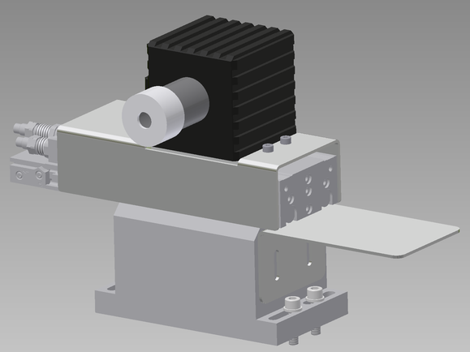](figures/jonas_review_m_regime/0804JL5526.png) | Lineareinheit | Die Baugruppe verfährt einen als Endeffektor montierten PowerMeter-Sensor über einen pneumatischen Aventics-Kompaktschlitten mit 100 mm Hub entlang genau einer Richtung (R = 0, T = 1). Da die Hauptfunktion das lineare Positionieren des Sensors ist, handelt es sich eindeutig um eine Lineareinheit. | 该装配体通过行程为 100 mm 的 Aventics 气动紧凑型滑台，使作为末端执行器安装的 PowerMeter 传感器沿恰好一个方向移动（R = 0，T = 1）。由于主要功能是对传感器进行直线定位，因此明确属于直线单元。 | passed | — | — |
| 64 | 0804JL5526 |  | Keine der verfügbaren Klassen | Die Baugruppe ist in Stückliste und Zeichnung irreführend als „Sensor“ mit dem Zusatz „PowerMeter“ benannt und zeigt im 3D-Modell prominent den Messkopf. Lässt man sich von dieser Benennung leiten und stuft Messen bzw. Prüfen als Nicht-Handhabungsfunktion ein, führt Schritt S1 zu Keine der verfügbaren Klassen. | 该装配体在物料清单和图纸中被容易引起误解地命名为带“PowerMeter”补充说明的“Sensor”（传感器），3D 模型中测量头也十分显眼。如果受这一名称引导，将测量或检测视为非操作功能，则按照步骤 S1 归为“不属于任何可用类别”。 | failed | — | — |
| 65 | 0804LE2661 | [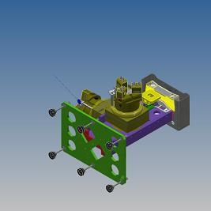](figures/jonas_review_m_regime/0804LE2661.png) | Greifer | Die Baugruppe ist in der Zeichnung als „Greifereinheit“ benannt und kombiniert einen Sauggreifer sowie zwei Parallelgreifer für das Aufnehmen von Werkstücken. Werden alle Greifantriebe sowie die Ausgleichsbewegungen dem Endeffektor bzw. passiven Hilfsfunktionen zugeordnet (R = 0, T = 0), handelt es sich um einen Greifer. | 该装配体在图纸中名为“Greifereinheit”（夹爪单元），组合了一个真空吸盘和两个平行夹爪，用于拾取工件。如果将所有夹持驱动及补偿运动归入末端执行器或被动辅助功能（R = 0，T = 0），则属于夹爪。 | passed | — | — |
| 66 | 0804LE2661 |  | Kombinierte Einheit | Neben dem Sauggreifer sind zwei orthogonal angeordnete Greif- bzw. Ausgleichseinheiten auf Linearführungen verbaut, wobei passive Ausgleichsbewegungen im Codebook nicht explizit geregelt sind. Werden diese verschieden gerichteten Verschiebeachsen als aktive translatorische Prozessaktoren mitgezählt (R = 0, T ≥ 2), ist die Zuordnung als Kombinierte Einheit vertretbar. | 除真空吸盘外，还安装了两个在直线导轨上相互正交布置的夹持或补偿单元，而 Codebook 未明确规定如何处理被动补偿运动。如果将这些不同方向的移动轴计为主动平移过程执行器（R = 0，T ≥ 2），则归为组合单元是合理的。 | failed | zwei greifköpfe, keine aktorik, nur anschlusskonsole | 两个夹持头，没有驱动机构，只有连接支架。 |
| 67 | 0804LE2661 |  | Rotationseinheit | Auf Basis der 3D-Bilder ist eine dominante zentrale Rotationsachse erkennbar, auf der mehrere Greifmodule montiert sind, während keine unabhängigen translatorischen Achsen die gesamte Baugruppe bewegen. Werden die Sauggreifer als Endeffektoren nicht mitgezählt (R = 1, T = 0), ergibt sich die Einstufung als Rotationseinheit. | 根据 3D 图像，可以识别出一个占主导地位的中央旋转轴，多个夹持模块安装在该轴上；同时，没有独立的平移轴驱动整个装配体运动。如果将真空吸盘视为末端执行器而不计入轴数（R = 1，T = 0），则归为旋转单元。 | failed | zwei greifköpfe, keine aktorik, nur anschlusskonsole | 两个夹持头，没有驱动机构，只有连接支架。 |
| 68 | 0804LE2661 |  | Keine der verfügbaren Klassen | In Stückliste und Zeichnungskopf wird die Baugruppe als „clamping device / Klemmung“ bezeichnet, was primär auf eine statische Halte- bzw. Befestigungsfunktion hinweist (Namens-Veto nach Prioritätsregel 1). Werden Sauggreifer, Vakuumkomponenten und Visionsystem als passive Aufspann- bzw. Fixiervorrichtung ohne eigene Bewegungsachse gewertet (R = 0, T = 0), führt dies zu Keine der verfügbaren Klassen. | 物料清单和图纸标题栏将该装配体称为“clamping device / Klemmung”（夹紧装置），这一名称主要指向静态保持或固定功能（优先规则 1 中的名称否决）。如果将真空吸盘、真空部件和视觉系统视为没有自身运动轴的被动装夹或固定装置（R = 0，T = 0），则归为“不属于任何可用类别”。 | failed | definitiv greifer | 明确属于夹爪。 |
| 69 | 0804AF9667 | [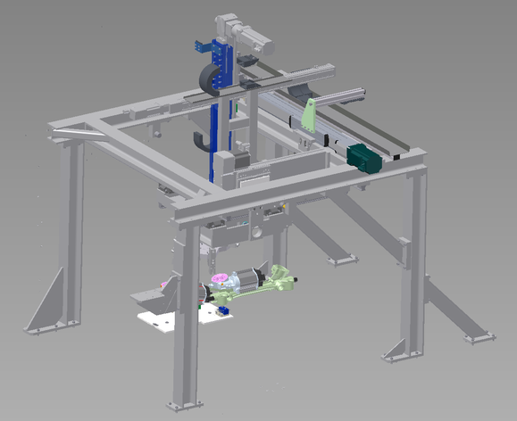](figures/jonas_review_m_regime/0804AF9667.png) | Multi-Achs-System (Gantry) | Die Baugruppe heißt „Portalachssystem“ und besitzt ein klassisches Vier-Stützen-Gestell mit beidseitig geführter erster Horizontalachse sowie orthogonalen X/Y/Z-Portalachsen. Wird die schwer erkennbare Winkelverstellung übersehen bzw. als Justage gewertet (R = 0, T = 3), erfüllt das System alle Kriterien für ein Multi-Achs-System bzw. Gantry. | 该装配体名为“Portalachssystem”（龙门轴系统），具有典型的四立柱机架、采用双侧导向的第一水平轴，以及相互正交的 X/Y/Z 龙门轴。如果忽略了不易辨认的角度调整机构，或将其视为调校功能（R = 0，T = 3），则该系统满足多轴系统（龙门）的全部判定条件。 | failed | Winkelverstellung ist als Verfahrweg in Zeichnung gekennzeichnet -&gt; Schwer zu erkennen, aber keine justage | 图纸将角度变化标注为运动行程 → 虽然不易辨认，但这并非仅用于调校。 |
| 70 | 0804AF9667 |  | Kombinierte Einheit | Laut Zeichnung und DFC-Stückliste verfügt das System über eine zusätzliche Verstellachse, die die Z-Achse über einen Lineartisch um ± 15° bzw. 12,5° im Winkel schwenkt. Zählt man diese Schwenkbewegung als Prozessachse mit (R = 1, T = 3) oder berücksichtigt die nicht mehr rein orthogonale Achsstellung, ist es streng genommen eine Kombinierte Einheit. | 根据图纸和 DFC 物料清单，该系统具有一个额外调整轴，通过直线工作台使 Z 轴产生 ± 15° 或 12.5° 的角度摆转。如果将该摆转运动计为过程轴（R = 1，T = 3），或考虑到轴间关系不再完全正交，则严格来说属于组合单元。 | passed | — | — |
| 71 | 0804LV8630 | [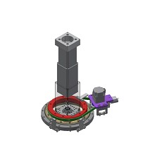](figures/jonas_review_m_regime/0804LV8630.png) | Rotationseinheit | Die Baugruppe heißt „Rotationseinheit“ und treibt über einen Gleichstrommotor mit Zahnriemen eine große Drehverbindung an, während der Antrieb der mittigen Säule in 3D-Modell und Zeichnung nicht direkt ersichtlich ist. Wird die Säule als passiver Ständer oder manuelle Höhenverstellung gewertet (R = 1, T = 0), ist es eine Rotationseinheit. | 该装配体名为“Rotationseinheit”（旋转单元），通过直流电机和同步带驱动大型回转支承，但 3D 模型和图纸中无法直接看出中央立柱的驱动。如果将该立柱视为被动支柱或手动高度调整机构（R = 1，T = 0），则属于旋转单元。 | passed | — | — |
| 72 | 0804LV8630 |  | Kombinierte Einheit | Laut DFC-Stückliste handelt es sich bei der zentralen Säule um eine elektrisch betätigte, dreistufige Teleskophubsäule mit integriertem 24V-Motor und 400 mm Hub. Zählt man diesen vertikalen Hubantrieb neben dem Drehantrieb als Prozessachse mit (R = 1, T = 1), ergibt sich eine Kombinierte Einheit. | 根据 DFC 物料清单，中央立柱为电动三级伸缩升降柱，集成 24 V 电机，行程为 400 mm。如果除旋转驱动外，也将该竖直升降驱动计为过程轴（R = 1，T = 1），则归为组合单元。 | passed | — | — |
| 73 | 0804CC2134 | [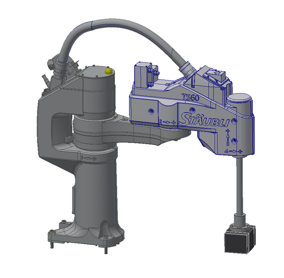](figures/jonas_review_m_regime/0804CC2134.png) | Roboter | Nach Regelwerk klar KE, aber nach gelebter Praxis / Funktionsweise eindeutig ein Roboter | 按照规则明确属于组合单元（KE），但按照实际应用惯例／工作方式，显然是一台机器人。 | passed | — | — |
| 74 | 0804CC2134 |  | Kombinierte Einheit | Der Roboter verfügt neben den Rotationsachsen zusätzlich über eine Linearachse (R ≥ 2, T ≥ 1). Nach der Entscheidungstabelle im Codebook führt diese Kombination aus Rotations- und Translationsachsen zwingend zu Klasse 4. | 该机器人除旋转轴之外，还具有一个直线轴（R ≥ 2，T ≥ 1）。根据 Codebook 中的决策表，这种旋转轴与平移轴的组合必须归为第 4 类。 | passed | — | — |
| 75 | 0804CC2134 |  | Keine der verfügbaren Klassen | Auf Basis der Bilder wird die Baugruppe als SCHUNK-Schnellwechselsystem SWS 011 mit roboterseitigem Wechselkopf (SWK) und werkzeugseitigem Adapter (SWA) erkannt. Da die Hauptfunktion das Kuppeln, Verriegeln und Versorgen eines Werkzeugs ist und die interne Pneumatik nur die Verriegelung betätigt (R = 0, T = 0, keine Greiffunktion), ergibt sich Keine der verfügbaren Klassen. | 根据图像，该装配体被识别为 SCHUNK SWS 011 快换系统，包含机器人侧的快换头（SWK）和工具侧的适配器（SWA）。由于主要功能是连接、锁紧工具并为其提供供应，内部气动机构仅驱动锁紧动作（R = 0，T = 0，没有夹持功能），因此归为“不属于任何可用类别”。 | failed | — | — |
| 76 | 0804CC2134 |  | Greifer | Wird das Schnellwechselsystem SWS 011 als Klemm- bzw. Haltevorrichtung für das Werkzeug interpretiert, liegen keine externen translatorischen oder rotatorischen Hauptachsen vor (R = 0, T = 0). Wird die Verriegelung des Werkzeugs als funktionale Greif- bzw. Klemmfunktion gewertet, führt der Entscheidungsablauf (Schritt S3, Fall A) zur Einstufung als Greifer. | 如果将 SWS 011 快换系统解释为工具的夹紧或保持装置，则不存在对外作用的平移或旋转主轴（R = 0，T = 0）。如果将工具锁紧视为功能上的夹持或夹紧功能，则决策流程（步骤 S3，情形 A）将其归为夹爪。 | failed | — | — |
| 77 | 0804CC2134 |  | Rotationseinheit | Wird die zylindersymmetrische Wechselschnittstelle des Schnellwechselsystems SWS 011 (SWK 011 / SWA 011) als rotationsbasierte Schnittstelle am Robotergelenk interpretiert (R = 1, T = 0), ergibt sich die Einstufung als Rotationseinheit. | 如果将 SWS 011 快换系统（SWK 011 / SWA 011）的圆柱对称快换接口解释为机器人关节处基于旋转的接口（R = 1，T = 0），则归为旋转单元。 | failed | — | — |
| 78 | 0804JX6656 | [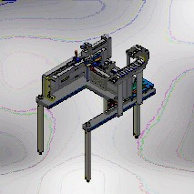](figures/jonas_review_m_regime/0804JX6656.png) | Multi-Achs-System (Gantry) | Die Baugruppe heißt „Achssystem“ und zeigt im 3D-Modell zwei orthogonale horizontale Linearachsen auf einem Vier-Stützen-Gestell, wobei das vordere Achsende auf einer zweiten Führungsschiene abgestützt wird. Auf Basis des 3D-Modells (R = 0, T = 2) sind damit alle Kriterien für ein Multi-Achs-System bzw. Gantry erfüllt. | 该装配体名为“Achssystem”（轴系统）；3D 模型显示了四立柱机架上的两个相互正交的水平直线轴，其中轴的前端由第二条导轨支承。根据 3D 模型（R = 0，T = 2），它满足多轴系统（龙门）的全部判定条件。 | passed | — | — |
| 79 | 0804JX6656 |  | Kombinierte Einheit | Im 3D-Modell wirkt die zweite Horizontalachse auf den ersten Blick einseitig auskragend, da die schmale Stützschiene am vorderen Ende gegenüber dem großen Hauptmodul nur schwer als beidseitige Führung erkennbar ist. Wird das dritte Gantry-Kriterium deshalb verneint (R = 0, T = 2), führt dies zur Einstufung als Kombinierte Einheit. | 3D 模型中的第二水平轴乍看呈单侧悬臂式结构，因为前端较窄的支撑导轨相对于大型主模块而言，不易被识别为双侧导向。如果因此判定不满足第三项龙门条件（R = 0，T = 2），则归为组合单元。 | failed | klare beidseitige Führung der ersten achse | 第一轴明确采用双侧导向。 |
| 80 | 0804JX6656 |  | Keine der verfügbaren Klassen | In der 2D-Zeichnung sind die angetriebenen Linearachsen nur als Strich-Zweipunkt-Referenzgeometrie dargestellt, und die DFC-Stückliste umfasst lediglich das passive Gestell mit Platten, Pfosten und Stützschiene ohne eigene Aktorik (R = 0, T = 0). Da weder Bewegungsaktor noch Greiffunktion enthalten sind, fällt die Baugruppe streng nach Stückliste unter Keine der verfügbaren Klassen. | 2D 图纸仅以双点划参考几何表示带驱动的直线轴，而 DFC 物料清单只包含由板件、立柱和支撑导轨构成的被动机架，不包含自身驱动机构（R = 0，T = 0）。由于既不包含运动执行器，也不包含夹持功能，严格依据物料清单，该装配体应归为“不属于任何可用类别”。 | passed | aktorik angedeutet, aber nicht in Stückliste | 图中暗示存在驱动机构，但物料清单中未列出。 |
| 81 | 0804JX6656 |  | Lineareinheit | Die als „Achssystem“ benannte Baugruppe enthält als bewegungsführende Komponenten ausschließlich Rexroth-Führungsschienen (Pos. 0102/0103, 480 mm bzw. 315 mm) mit Führungswagen (Pos. 0104) sowie eine Energiekette; Motoren, Rotationsantriebe oder Greifbacken sind nicht aufgeführt und die vier Pfosten dienen lediglich als Gestell. Wird nur eine translatorische Achse gezählt bzw. das System als mehrachsige Linearführung ohne Gantry-Charakter gewertet (R = 0, T = 1 bzw. T = 2), wird die Baugruppe als Lineareinheit eingestuft. | 该装配体名为“Achssystem”（轴系统），用于引导运动的部件仅包含 Rexroth 导轨（位置号 0102/0103，长度分别为 480 mm 和 315 mm）、导向滑块（位置号 0104）以及一条拖链；清单中未列出电机、旋转驱动或夹爪，四根立柱仅构成机架。如果只计入一个平移轴，或将该系统视为不具龙门特征的多轴直线导向机构（R = 0，T = 1 或 T = 2），则归为直线单元。 | failed | entweder man nimmt beide aktoren an, oder keinen | 要么认定两个执行器都存在，要么都不认定存在。 |
| 82 | 0804KW8391 | [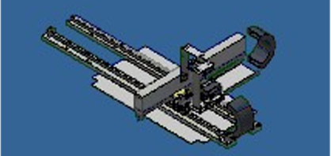](figures/jonas_review_m_regime/0804KW8391.png) | Multi-Achs-System (Gantry) | Die Baugruppe heißt „Achssystem“ und zeigt im 3D-Modell zwei orthogonale horizontale Linearachsen, wobei die erste Richtung über zwei parallele Führungsschienen doppelt geführt wird. Werden beide Achsen als aktive Prozessachsen gezählt (R = 0, T = 2) und die Doppelschiene als beidseitige Führung gewertet, ergibt sich ein Multi-Achs-System bzw. Gantry. | 该装配体名为“Achssystem”（轴系统）；3D 模型显示两个相互正交的水平直线轴，其中第一方向通过两条平行导轨实现双重导向。如果将两个轴均计为主动过程轴（R = 0，T = 2），并将双导轨视为双侧导向，则归为多轴系统（龙门）。 | passed | — | — |
| 83 | 0804KW8391 |  | Kombinierte Einheit | Obwohl im 3D-Modell eine horizontale X/Y-Bewegung vorliegt, wird die Querachse nicht an ihren beiden äußeren Enden als Portalbrücke geführt, sondern ragt seitlich über die zwei eng beieinanderliegenden Schienen hinaus. Da das dritte Gantry-Kriterium somit streng genommen nicht erfüllt ist (R = 0, T = 2), ist die Einstufung als Kombinierte Einheit vertretbar. | 虽然 3D 模型显示存在水平 X/Y 运动，但横向轴并未在两个外端像龙门桥架一样得到导向，而是从两条间距较小的导轨向侧面悬伸。因此，严格来说不满足第三项龙门判定条件（R = 0，T = 2），归为组合单元是合理的。 | passed | führung beidseitig, aber kragt aus | 虽然采用双侧导向，但仍有悬伸部分。 |
| 84 | 0804KW8391 |  | Keine der verfügbaren Klassen | Laut DFC-Stückliste mit dem Zusatz „Manual Handling System“ und 2D-Zeichnung, in der die Querachse nur als Strich-Zweipunkt-Referenzlinie angedeutet ist, umfasst diese Baugruppennummer lediglich passive Führungsschienen, Wagen, Klemmelement und Messband ohne jeden Antriebsaktor (R = 0, T = 0). Ohne Aktorik und Greiffunktion fällt die Baugruppe nach Codebook unter Keine der verfügbaren Klassen. | 根据带有“Manual Handling System”（手动操作系统）补充说明的 DFC 物料清单，以及仅用双点划参考线示意横向轴的 2D 图纸，该装配体编号仅涵盖被动导轨、滑块、夹紧元件和测量带，不包含任何驱动执行器（R = 0，T = 0）。由于没有驱动机构和夹持功能，按照 Codebook 应归为“不属于任何可用类别”。 | failed | — | — |
| 85 | 0804KW8391 |  | Lineareinheit | Laut Stückliste (Pos. 0106–0108) besteht die Baugruppe aus Bosch-Rexroth-Kugelschienenführungen (R1605) mit Führungswagen, ergänzt um ein SICK-Messsystem (TTK70 mit Magnetband), Energieführungsketten und Klemmelemente; rotatorische Antriebe, Greifbacken oder Schwenkeinheiten sind nicht enthalten. Wird die beidseitig geführte Anordnung auf zwei parallelen Schienen als eine translatorische Achse gewertet (R = 0, T = 1), ergibt sich die Einstufung als Lineareinheit. | 根据物料清单（位置号 0106–0108），该装配体由带滑块的 Bosch-Rexroth 滚珠导轨（R1605）组成，并配有 SICK 测量系统（TTK70 和磁性测量带）、拖链及夹紧元件；不包含旋转驱动、夹爪或摆转单元。如果将两条平行导轨上的双侧导向结构视为一个平移轴（R = 0，T = 1），则归为直线单元。 | failed | — | — |
| 86 | 0804LU7693 | [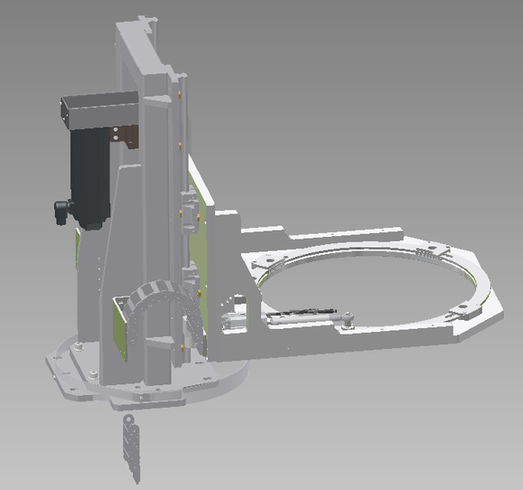](figures/jonas_review_m_regime/0804LU7693.png) | Lineareinheit | Die Baugruppe heißt „Hubeinheit“ und dient im Kern dem vertikalen Verfahren über die große Rexroth-Antriebseinheit mit 350 mm Hub. Wird der zweite Antrieb auf der Frontplatte lediglich der Greifschale als Endeffektor bzw. Klemmfunktion zugeordnet und nicht mitgezählt (R = 0, T = 1), ergibt sich eine Lineareinheit. | 该装配体名为“Hubeinheit”（升降单元），核心功能是通过大型 Rexroth 驱动单元实现竖直移动，行程为 350 mm。如果将前面板上的第二个驱动仅归入作为末端执行器的夹持托槽或夹紧功能，而不计入轴数（R = 0，T = 1），则归为直线单元。 | passed | tatsächlich erwirkt der 2.Aktor eine drehfunktion. Allerdings ist unklar, ob das nur dem Auswerfen dient | 第二个执行器实际上产生了旋转运动，但尚不清楚这一运动是否仅用于顶出。 |
| 87 | 0804LU7693 |  | Kombinierte Einheit | Laut Stückliste sind zwei separate Hauptaktoren verbaut: die vertikale Rexroth-Antriebseinheit sowie ein zusätzlicher Servomotor mit Festo-Linearschlitten für 100 mm Hub an der vorderen Baugruppe. Werden beide Antriebe als unabhängige Prozessachsen gezählt (R + T ≥ 2), ist die Baugruppe nach Codebook zwingend eine Kombinierte Einheit. | 根据物料清单，装配体中安装了两个独立的主要执行器：竖直 Rexroth 驱动单元，以及前部装配体上的额外伺服电机和行程为 100 mm 的 Festo 直线滑台。如果将两个驱动均计为独立过程轴（R + T ≥ 2），则按照 Codebook，该装配体必须归为组合单元。 | passed | tatsächlich erwirkt der 2.Aktor eine drehfunktion. Allerdings ist unklar, ob das nur dem Auswerfen dient | 第二个执行器实际上产生了旋转运动，但尚不清楚这一运动是否仅用于顶出。 |
| 88 | 0804HK5576 | [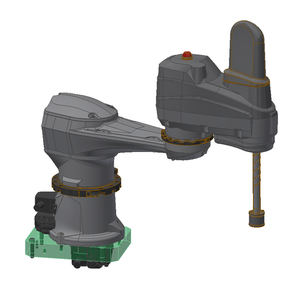](figures/jonas_review_m_regime/0804HK5576.png) | Roboter | Nach Regelwerk klar KE, aber nach gelebter Praxis / Funktionsweise eindeutig ein Roboter | 按照规则明确属于组合单元（KE），但按照实际应用惯例／工作方式，显然是一台机器人。 | passed | — | — |
| 89 | 0804HK5576 |  | Kombinierte Einheit | Der Roboter verfügt neben den Rotationsachsen zusätzlich über eine Linearachse (R ≥ 2, T ≥ 1). Nach der Entscheidungstabelle im Codebook führt diese Kombination aus Rotations- und Translationsachsen zwingend zu Klasse 4. | 该机器人除旋转轴之外，还具有一个直线轴（R ≥ 2，T ≥ 1）。根据 Codebook 中的决策表，这种旋转轴与平移轴的组合必须归为第 4 类。 | passed | — | — |
| 90 | 0804KR9668 | [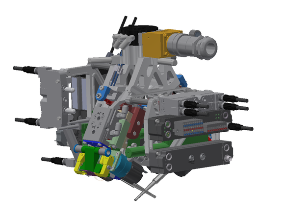](figures/jonas_review_m_regime/0804KR9668.png) | Greifer | Die Baugruppe heißt „Greifereinheit“ bzw. „Robot gripper Flexfoil“ und kombiniert zwei Unterbaugruppen-Greifer mit Vakuum-Ejektoren, Wegeventilen und einem Schunk-Schnellwechseladapter. Werden alle Antriebe als Teil dieses komplexen Doppelgreifers nicht mitgezählt (R = 0, T = 0), wird sie als Greifer eingestuft. | 该装配体名为“Greifereinheit”（夹爪单元）或“Robot gripper Flexfoil”，集成了两个下级夹爪装配体、真空发生器、换向阀和 Schunk 快换适配器。如果将所有驱动都视为这一复杂双夹爪的一部分而不计入轴数（R = 0，T = 0），则归为夹爪。 | passed | — | — |
| 91 | 0804KR9668 |  | Keine der verfügbaren Klassen | Aufgrund der hochkomplexen Sonderkonstruktion ohne 3D-Modell und ohne Unterstücklisten der Greifer-Submodule lässt sich aus den Dokumenten nicht eindeutig erschließen, ob lediglich gegriffen oder ein Füge- bzw. Prüfprozess ausgeführt wird. Bei unklarer Handhabungsfunktion bzw. als passiver Grundträger ohne direkt sichtbare Greifaktorik (R = 0, T = 0) führt dies zu Keine der verfügbaren Klassen. | 由于该装配体是高度复杂的专用结构，且缺少 3D 模型和夹爪子模块的下级物料清单，无法仅凭资料明确判断它是只执行夹持，还是执行装配连接或检测过程。如果操作功能不明确，或将其视为没有直接可见夹持驱动机构的被动基础支架（R = 0，T = 0），则归为“不属于任何可用类别”。 | passed | — | — |
| 92 | 0804KR9668 |  | Kombinierte Einheit | Nur von einem menschlichen Annotator markiert; im Ausgangsblatt ist keine Begründung hinterlegt und die Klasse wurde von keinem LLM vergeben. | 仅由一名人工标注者选中；原始工作表未记录理由，也没有任何 LLM 给出该类别。 | failed | — | — |
| 93 | 0804DU5389 | [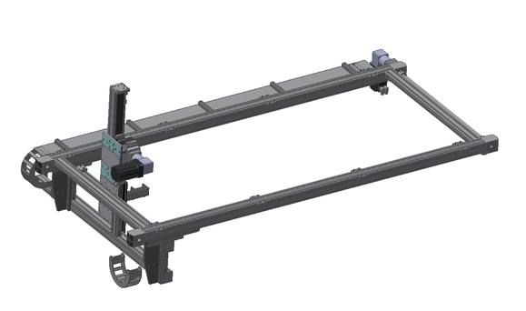](figures/jonas_review_m_regime/0804DU5389.png) | Multi-Achs-System (Gantry) | Die Baugruppe heißt „Achssystem“ und besteht aus einem dreiachsigen Schneider-Electric-Achspositioniersystem MAXK mit orthogonalen X/Y/Z-Achsen (R = 0, T = 3), bei dem das Portal über eine Kardanwelle an beiden Enden auf zwei parallelen Linearachsen geführt wird. Damit sind alle Gantry-Kriterien für ein Multi-Achs-System erfüllt. | 该装配体名为“Achssystem”（轴系统），由 Schneider Electric MAXK 三轴定位系统组成，具有相互正交的 X/Y/Z 轴（R = 0，T = 3）；其龙门通过万向传动轴，在两端沿两条平行直线轴导向。因此满足多轴系统的全部龙门判定条件。 | passed | — | — |
| 94 | 0804DU5389 |  | Kombinierte Einheit | In der Stückliste findet sich neben der Angabe „X/Y/Z Achse“ auch der widersprüchliche Zusatztext „P1: 2-Achssystem“, und es ist kein klassisches Stützengestell enthalten. Wird das System aufgrund des Zusatztextes fälschlicherweise als reines X/Z-Zweiachssystem ohne zweite Horizontalachse interpretiert oder die Z-Achse als Drehachse missverstanden, führt dies zur Einstufung als Kombinierte Einheit. | 物料清单除“X/Y/Z Achse”（X/Y/Z 轴）之外，还包含与之矛盾的补充文字“P1: 2-Achssystem”（P1：双轴系统），且不包含典型立柱机架。如果依据补充文字，错误地将其解释为缺少第二水平轴的纯 X/Z 双轴系统，或将 Z 轴误认为旋转轴，则归为组合单元。 | failed | — | — |
| 95 | 0804DU5389 |  | Lineareinheit | Nur von einem menschlichen Annotator markiert; im Ausgangsblatt ist keine Begründung hinterlegt und die Klasse wurde von keinem LLM vergeben. | 仅由一名人工标注者选中；原始工作表未记录理由，也没有任何 LLM 给出该类别。 | failed | — | — |
| 96 | 0804LW3879 | [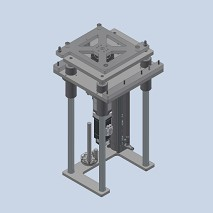](figures/jonas_review_m_regime/0804LW3879.png) | Lineareinheit | Die Baugruppe heißt „Hubeinheit“ und führt über einen großen Festo-Pneumatikzylinder mit 400 mm Hub und vier Führungswellen eine vertikale Hubbewegung aus. Wird die enthaltene Unterbaugruppe Rotationseinheit als passiv bzw. nicht angetrieben gewertet (R = 0, T = 1), handelt es sich um eine Lineareinheit. | 该装配体名为“Hubeinheit”（升降单元），通过行程为 400 mm 的大型 Festo 气缸和四根导向轴，实现竖直升降运动。如果将其中的旋转单元子装配体视为被动或无驱动（R = 0，T = 1），则属于直线单元。 | failed | — | — |
| 97 | 0804LW3879 |  | Kombinierte Einheit | Laut Stückliste und Zeichnung ist neben dem vertikalen Hubzylinder zusätzlich eine Unterbaugruppe „Rotationseinheit“ für eine Drehung um die Hochachse verbaut. Wird diese Drehbewegung um die Vertikalachse als aktiver rotatorischer Freiheitsgrad mitgezählt (R = 1, T = 1), ist die Zuordnung als Kombinierte Einheit vertretbar. | 根据物料清单和图纸，除竖直升降气缸外，还安装了用于绕竖直轴旋转的“Rotationseinheit”（旋转单元）子装配体。如果将该绕竖直轴的旋转运动计为主动旋转自由度（R = 1，T = 1），则归为组合单元是合理的。 | passed | ganz klar rotation mit linearbewegung überlagert | 明显存在旋转运动与直线运动的叠加。 |
